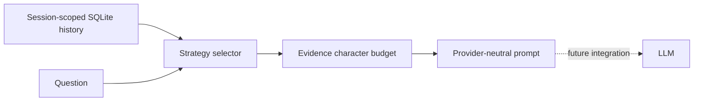

# Design

The store uses parameterized SQL and a connection per operation. Selectors are pure and deterministic. Lexical retrieval scans one session in Python: a small-data baseline, not a production index. No encryption, authentication, quotas, TTL or pagination is implemented.

Selection greedily admits fitting messages, caps their count, then sorts them chronologically. Hybrid interleaves retrieval and recency without reserved quotas. Oversized messages are skipped; compact uses explicit truncated previews. A source ID identifies evidence, not a verified fact.

Tests exercise persistence, session isolation, scoped deletion, SQL parameters, recency, conflicts, tie-breaking, empty results, Unicode budgets, truncation, deduplication, validation and prompt role separation. They do not measure model accuracy or prove injection resistance.

## Next experiments

1. Expand the v0.2 synthetic evaluation fixture into a separate held-out query set. The current five queries measure source and exact-excerpt recall at equal budgets; they are teaching examples, not independent evidence of generalization.
2. Compare embeddings against lexical retrieval on paraphrases.
3. Add a separate model-summary adapter and test coverage of corrections.
4. Implement user-confirmed facts with sources, expiry and update/delete semantics.
5. Add model-specific token counting and evaluate generated answers separately.
